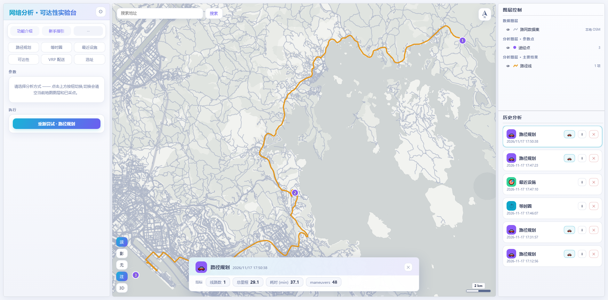
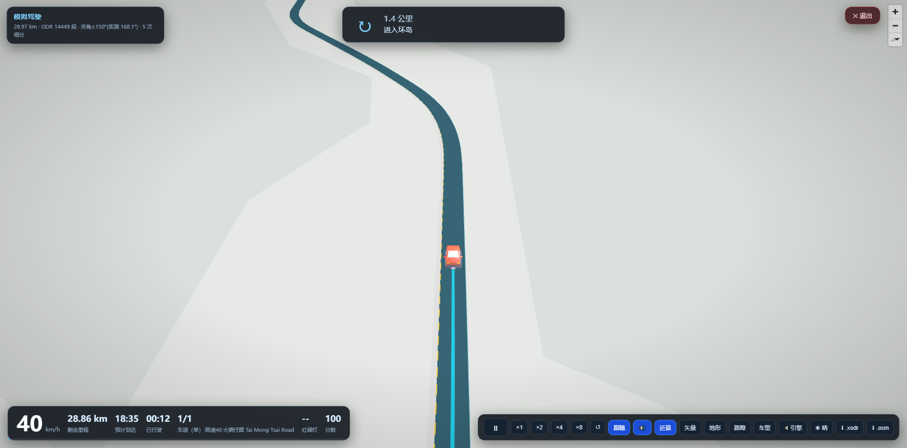

# OSM Network Analysis & Automatic Drive Simulation

基于 OpenStreetMap 的网络分析与自动驾驶路线回放示例。项目包含 OSM PBF 数据处理、Valhalla 路由、FastAPI 服务、Vue 3 地图前端，以及**仅自动巡航**的 3D 路线模拟。

> 这是本地开发 / 研究示例，不是面向公网开放的生产部署。不要将未加认证的 API 直接暴露到互联网。

## 能力

- 路径规划（可选备选路线）、最近设施、等时圈、选址、VRP 配送、2SFCA 可达性。
- 从 OSM 路段提取车道、限速、道路方向和信号灯属性，生成 OpenDRIVE / Lanelet2 导出。
- 浏览器自动模拟导航：路线巡航、中文转向提示、路网与 3D 车道场景、交通车辆 / 行人、碰撞计分和天气效果。
- 本地构建出 `roads_cn.mbtiles` 后，分析地图会自动显示香港 OSM 路网；天地图密钥未配置时不会请求无效注记瓦片。
- 地图范围由输入 OSM 自动推导：初始视野、拖动和缩放都限制在该区域，无需手工配置坐标。
- 自动驾驶入口独立为 `webapp/public/driving.html`；本仓库不包含手动驾驶页面或手动驾驶入口。

## 实际用途与意义

这个项目把“一份 OSM 数据”变成一套可直接演示和验证的网络分析环境，主要用在：

| 场景 | 能做什么 | 价值 |
|---|---|---|
| 公共服务可达性评估 | 2SFCA / 最近设施 / 等时圈，衡量医院、学校、消防站等在给定出行时间内覆盖多少人口 | 把“有没有设施”换成“多久能到”，支持公平性与资源缺口判断 |
| 设施选址 | P-中值、最大覆盖、容量约束、市场份额等目标下比较候选点 | 用路网真实成本替代直线距离，减少拍脑袋选址 |
| 配送与车辆调度 | VRP 派单、容量/时长约束、真实路径输出 | 小规模配送方案可以在本机快速试算和可视化复核 |
| 交通与城市研究 | OSM 车道、限速、单行、信号灯属性提取；导出 OpenDRIVE / Lanelet2 | 为仿真、自动驾驶测试和教学提供可复现的路网底稿 |
| 方案沟通与教学 | 浏览器地图 + 一键自动驾驶回放，中文转向提示 | 非 GIS 专业同事也能看懂分析结果和路线走向 |
| 数据质量检查 | 同一链路跑不同区域/时间快照，比较路网与属性完整度 | 快速发现 OSM 缺失车道、断头路、信号灯标注问题 |

核心意义：**降低“OSM → 可计算路网 → 可解释结果”的门槛**。用户不需要先学 Valhalla 构建、瓦片切图和前端部署，只要给一个 PBF，就能得到可交互的分析平台和仿真演示。

## 技术组成

| 层 | 技术 | 输入 / 输出 |
|---|---|---|
| OSM 数据处理 | OSM PBF、Valhalla tools、pyosmium、GDAL/OGR、Tippecanoe | PBF → 路由 tiles、道路属性 SQLite、MVT MBTiles |
| 后端 | Python 3.11+、FastAPI、Uvicorn | 分析 API、Valhalla 代理、历史记录、静态文件/MVT |
| 路由引擎 | Valhalla | route、sources-to-targets、isochrone、trace attributes |
| 前端 | Vue 3、Vite、MapLibre GL JS、Three.js | 交互分析地图、自动驾驶仿真 |
| 持久化 | SQLite / GeoJSON | OSM 道路索引、运行历史、矩阵缓存 |

完整系统架构、API 契约和数据处理说明：[`docs/ARCHITECTURE.md`](docs/ARCHITECTURE.md)、[`docs/DATA_PROCESSING.md`](docs/DATA_PROCESSING.md)。

## 页面截图

**路径规划与分析结果**



**自动驾驶（近景 / 转向提示）**



## 在线打开 Demo

GitHub Pages 已开启，直接用浏览器打开：

**https://srmaper.github.io/osm-valhalla-network-analysis/**

（单页入口：`driving-offline.html`，含红绿灯、3D 车模和导航提示。）

## 单文件自动驾驶页（离线打开）

`docs/driving-offline.html` 是**现有 `/driving.html` 的单文件打包版**，不是另做的简化版：

- 与在线版同源：同一页面模板、同一 MapLibre/three.js、同一 3D 车模、同一 HUD 和转向提示；
- 所有页面资源（MapLibre JS/CSS/worker、three.js、GLTFLoader、GLB 车模、路线数据）都内联在文件里，**双击即可打开，不需要启动服务**；
- 示例路线为**佐敦 → 旺角（弥敦道）**，含路口与红绿灯；该路线的道路属性（车道、限速、信号灯）已内嵌，离线也能显示红绿灯倒计时和右转规则；
- 底图仍按原页面请求在线地图服务（CARTO / Esri / 天地图），联网时显示底图；网络不可用时自动退到纯色底图，车道、车辆、导航和红绿灯照常运行。

重新生成单文件（换 OSM 数据后一键处理会自动更新）：

```bash
python3 scripts/build_offline_driving.py
```

## 仓库数据

- `data/input/hong-kong-261113.osm.pbf`：香港 OSM 示例快照（约 36 MiB），用于复现处理流程。
- 仓库自带数据只是默认示例；替换 `data/input/` 里的 PBF 后，地图范围会自动跟着新数据更新（见下一节）。
- `data/samples/`：小型分析点集和从示例 PBF 提取的路线 GeoJSON。
- `data/generated/`：构建生成的 Valhalla tiles、MVT 和道路属性索引；不提交。
- `data/runtime/`：运行历史、临时结果和缓存；不提交。

OSM 数据署名与数据许可证见 [`docs/OSM_ATTRIBUTION.md`](docs/OSM_ATTRIBUTION.md)。代码使用 MIT；这不改变 OSM 数据自身的 ODbL 条款。

## OSM 数据放哪里 / 如何替换

**约定目录：`data/input/`，文件名以 `.osm.pbf` 结尾。**

- 仓库默认自带香港数据：`data/input/hong-kong-261113.osm.pbf`（约 36 MiB），克隆后可直接一键跑通。
- 想换地区，只要把新的 PBF 放进同一目录（可保留旧文件，也可删掉）：

```text
data/input/
├── hong-kong-261113.osm.pbf      # 默认自带
└── sichuan-latest.osm.pbf        # 你自己放的，任意地区
```

然后执行 `bash scripts/oneclick.sh`（不给参数时自动选最新的 `.osm.pbf`），或直接指定文件/链接：

```bash
bash scripts/oneclick.sh data/input/sichuan-latest.osm.pbf
bash scripts/oneclick.sh https://download.geofabrik.de/asia/china-latest.osm.pbf
```

替换数据后，链路会自动把它“合成”为系统底图：

1. 重新计算地图范围（初始视野、拖动/缩放边界都换到新区域）；
2. 重新生成演示路线和示例点集；
3. 道路索引与矢量瓦片按新数据重建；
4. 若检测到 PBF 变化，Valhalla 路由图会重建，旧图自动备份为 `data/generated/valhalla.prev-*`。

> 只更换 PBF 却继续用旧路由图会导致“地图是新区域、路径却是旧区域”的错误，脚本已用 `data/generated/source.sha256` 校验并自动重建。若手动设置了外部 `VALHALLA_CONFIG`，脚本会给出警告，需自行确认该图覆盖新区域。
>
> Geofabrik 的全国/大洲级 PBF 体积很大，Valhalla 与瓦片构建需要数倍磁盘空间和较长 CPU 时间；建议先用小区域（如单个城市或特别行政区）验证流程。

## 一键处理与启动（推荐）

前提只有一条：**Linux / WSL2**（脚本会以 root/sudo 自动补全依赖）。

一键处理启动时会先做环境自检，缺什么就尝试装什么：

| 依赖 | 自动补全方式 |
|---|---|
| Python 3.11+ / venv / pip | `apt-get install python3 python3-venv python3-pip` |
| GDAL / ogr2ogr | `apt-get install gdal-bin` |
| Tippecanoe | 安装编译依赖后从源码构建（约几分钟） |
| Node.js / npm | `apt-get install nodejs npm`；WSL 里没有则借用 Windows 侧 Node |
| Valhalla 命令行 | 优先复用本机安装；有 `valhalla-bin` 包则安装，否则给出配置指引 |
| Python 依赖（pyosmium 等） | 自动在 `~/.cache/osm-valhalla/venv` 建虚拟环境并 `pip install` |

补全完成后会直接继续构建并启动服务。跳过补全用 `--no-setup`，只看检测结果用 `--check`。

```bash
python3 -m venv .venv && source .venv/bin/activate
pip install -r requirements.txt

# 本地文件
bash scripts/oneclick.sh /path/to/region.osm.pbf

# 或直接给 Geofabrik 下载链接（自动下载到 data/input/）
bash scripts/oneclick.sh https://download.geofabrik.de/asia/hong-kong-latest.osm.pbf
```

一条命令会依次完成：

1. 解析 PBF，生成 `webapp/public/regions/region.json`（区域名、bbox、中心、缩放）。
2. 从路网中挑选最长可行驶道路，生成自动驾驶演示路线和合成分析点集。
3. 构建 Valhalla 路由图（已存在则跳过）。
4. 扫描道路属性与信号灯，生成 `osm_idx.sqlite`。
5. 生成 OSM 矢量瓦片 `roads_cn.mbtiles`（已存在则跳过）。
6. 构建前端并启动 Valhalla + FastAPI。

完成后打开 `http://127.0.0.1:8004/network/`，API 文档在 `/docs`。日志与 PID 在 `.run/`。

常用参数：

```bash
bash scripts/oneclick.sh region.osm.pbf --build-only   # 只处理数据，不启动服务
SKIP_WEB=1 bash scripts/oneclick.sh region.osm.pbf     # 复用已有 webapp/dist
VALHALLA_CONFIG=/opt/valhalla/data/valhalla.json \
  bash scripts/oneclick.sh region.osm.pbf              # 复用已有 Valhalla 图
NA_PORT=8080 VALHALLA_PORT=8002 bash scripts/oneclick.sh region.osm.pbf
```

Windows 可直接双击仓库根目录的 **`一键处理.bat`**（内部走 WSL），或带参数运行：

```bat
一键处理.bat D:\osm\hong-kong-latest.osm.pbf
一键处理.bat -Check
```

首次运行细节：

- 自动创建仓库内 `.venv` 并安装 `requirements.txt`（无需手工配 Python）。
- 没给参数时优先使用 `data/input/` 下最新的 `.osm.pbf`；双击启动会提示输入路径，可直接拖入文件。
- 已安装的 Valhalla（例如 `/opt/valhalla/data`）会被自动复用，不重复建图；需要自定义时设置 `VALHALLA_CONFIG`。
- WSL 没有 Node 时，会借用 Windows 侧 Node/npm 构建前端。
- 出错窗口会停住并显示原因；环境自检用 `一键处理.bat -Check`。日志在 `.run/valhalla.log`、`.run/api.log`。

常见“点了没反应”的排查顺序：`-Check` → 看 `.run/api.log` 和 `.run/valhalla.log` → 确认 8002/8004 端口未被占用。

单独运行各步骤（`build_all.sh` / `build_valhalla.sh` / `build_mvt.sh` / `build_web.sh`）仍保留，适合调试或分机构建。构建脚本默认不覆盖已有 Valhalla 输出或 MBTiles，重建前请先移走旧产物。

## API 速览

| 方法 | 路径 | 用途 |
|---|---|---|
| `POST` | `/api/route` | 路线与中文 maneuver |
| `POST` | `/api/road_info` | 路线道路属性、车道和信号灯 |
| `POST` | `/api/closest`、`/api/service`、`/api/vrp`、`/api/loc-alloc`、`/api/2sfca` | 网络分析 |
| `GET` | `/api/runs`、`/api/runs/{id}/result` | 历史运行记录 |
| `GET` | `/mvt/cn/{z}/{x}/{y}.mvt` | OSM 矢量路网瓦片 |
| `GET` | `/health` | 服务状态 |

交互式 API 文档：`http://127.0.0.1:8004/docs`。

## 自动驾驶演示

分析一条路线后，在结果卡点击 🚗，页面读取路线结果并打开自动模拟驾驶。也可以直接打开 `/driving.html` 载入随仓库提供的香港示例路线。车辆、车道、路口和仿真规则均由浏览器页面驱动；Valhalla 负责规划和网络成本，不负责实时物理仿真。

## 开发与验证

```bash
cd webapp && npm ci && npm run build
cd .. && python -m compileall -q na_app na_tool.py scripts
```

更完整的本地端到端验证依赖生成的 Valhalla tiles、道路索引和 MVT 文件。

## License

代码：MIT（见 [`LICENSE`](LICENSE)）。OSM 数据：ODbL；底图和第三方 JS/3D 资产按各自条款使用，见 [`docs/OSM_ATTRIBUTION.md`](docs/OSM_ATTRIBUTION.md) 与 [`docs/THIRD_PARTY_NOTICES.md`](docs/THIRD_PARTY_NOTICES.md)。
